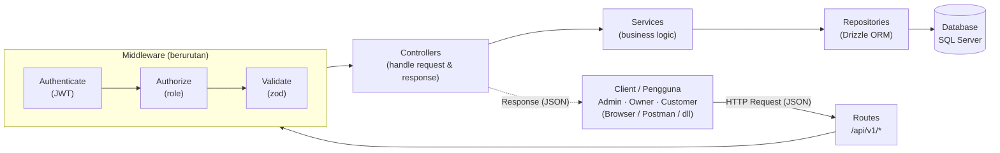

# Canteen Review API (Validasi, Error, dan Auth)

**Express 5 + Drizzle ORM + SQL Server** · zod · JWT · bcrypt · Swagger/OpenAPI

Lanjutan Tugas 2, ditambah:

- ✅ **Validasi input** dengan **zod** (query, params, body) lewat middleware `validate`
- ✅ **Satu format error** untuk semua jenis kegagalan
- ✅ **Autentikasi JWT** (register, login, `/auth/me`) + password di-hash **bcrypt**
- ✅ **Otorisasi role** `admin` / `owner` / `customer`, dengan **401 vs 403** dibedakan
- ✅ **Dokumentasi Swagger/OpenAPI** di `/docs`

---

## 🏗️ Arsitektur Sistem



```
routes -> (authenticate -> authorize -> validate) -> controllers -> services -> repositories -> db (Drizzle)
```

> Urutan middleware sengaja `authenticate` → `authorize` → `validate`: request tanpa token selalu **401** apa pun isi body-nya, jadi aturan validasi tidak bocor ke pengguna anonim. Error dari semua lapisan ditangkap di satu tempat: `middlewares/errorHandler.ts`.

---

## ▶️ Menjalankan

1. **Install dependency**
```bash
   npm install
```
2. **Buat file `.env`** di root project, lalu isi `DB_USER` / `DB_PASSWORD`, dan **`JWT_SECRET`** (wajib; server menolak start kalau kosong).
```env
   DB_SERVER=localhost
   DB_PORT=1433
   DB_USER=praktikum_user
   DB_PASSWORD=isi_password_kamu
   DB_NAME=review_kantin
   DB_ENCRYPT=false
   DB_TRUST_SERVER_CERTIFICATE=true

   JWT_SECRET=isi_string_acak_yang_panjang
   JWT_EXPIRES_IN=2h
   BCRYPT_SALT_ROUNDS=10
```
   Contoh membuat `JWT_SECRET` acak:
```bash
   node -e "console.log(require('crypto').randomBytes(32).toString('hex'))"
```
3. **Jalankan SQL di SQL Server** secara berurutan (folder `database/`):
```
   01-create-database-and-user.sql
   02-schema.sql
   03-seed.sql
   04-seed-password-hashes.sql
```
   - `04` mengganti password placeholder seed dengan hash bcrypt asli agar akun seed bisa login.
   - `00-setup-mixed-mode.sql` bersifat opsional: dipakai bila instance SQL Server masih *Windows-only* dan perlu mengaktifkan SQL Authentication (mixed mode).
4. **Start server**
```bash
   npm run dev
```
   Cek di <http://localhost:3000/health>
5. **Dokumentasi interaktif:** <http://localhost:3000/docs> (spec JSON: `/docs.json`)

| Script | Fungsi |
|---|---|
| `npm run dev` | Jalankan dengan auto-reload (`tsx watch`) |
| `npm start` | Jalankan sekali |
| `npm run typecheck` | Cek tipe TypeScript (`tsc --noEmit`) |

---

## 👤 Akun Uji

Password semua akun seed: **`rahasia123`**

| Role | Email | Keterangan |
|---|---|---|
| admin | `admin@kantin.test` | akses semua endpoint |
| owner | `tini@kantin.test` | pemilik stall id 1 (Warung Bu Tini) |
| owner | `slamet@kantin.test` | pemilik stall id 3 (Kedai Pak Slamet) |
| customer | `bagas@student.test` | customer biasa |

Akun seed lain: owner `makmur`, `caknur`, `wati`, `bayu`, `andre`, `inah`, `sari`, `hasan` (`@kantin.test`) dan customer `sinta`, `yoga`, `dewi` (`@student.test`).

**Pendaftaran mandiri** (`POST /auth/register`) selalu menghasilkan role `customer`. Akun dengan role lain hanya bisa dibuat admin lewat `POST /users`.

---

## 🔑 Autentikasi JWT

Login berhasil mengembalikan token yang dipakai di header setiap request yang butuh login:

```
Authorization: Bearer <token>
```

```json
{
  "status": "success",
  "message": "...",
  "data": {
    "token": "eyJhbGciOi...",
    "token_type": "Bearer",
    "expires_in": "2h",
    "user": { "id": 2, "name": "Bu Tini", "email": "tini@kantin.test", "role": "owner" }
  }
}
```

- Algoritma `HS256`, masa berlaku default `2h` (`JWT_EXPIRES_IN`).
- Payload hanya berisi `sub` (id), `name`, `email`, `role`. **Password tidak pernah masuk token.**
- Password disimpan sebagai hash bcrypt (`$2b$10$...`), cost diatur `BCRYPT_SALT_ROUNDS`.
- Login gagal selalu menjawab `Email atau password salah` (email tidak terdaftar dan password salah dibuat sama agar email tidak bisa ditebak).

---

## 🔒 Hak Akses Endpoint (prefix `/api/v1`)

| Endpoint | Akses |
|---|---|
| `GET /stalls`, `GET /stalls/:id` | publik |
| `POST /auth/register`, `POST /auth/login` | publik |
| `GET /auth/me` | login (semua role) |
| `POST /stalls/:id/reviews` | login (semua role) |
| `POST /stalls` | owner, admin |
| `PUT /stalls/:id` | owner (**hanya miliknya**), admin |
| `DELETE /stalls/:id` | admin |

**Endpoint lanjutan (Tugas 2) ikut diamankan:**

| Endpoint | Akses |
|---|---|
| `GET /menu-items`, `GET /menu-items/:id`, `GET /reviews`, `GET /reviews/:id` | publik |
| `POST/PUT/DELETE /menu-items` | owner (hanya kantin miliknya), admin |
| `DELETE /reviews/:id` | penulis review, admin |
| `POST /likes`, `DELETE /likes/:id` | login (semua role); hapus hanya pemilik like / admin |
| `GET/POST /users` | admin |
| `GET /flags`, `PUT /flags/:id` | admin |
| `GET/POST /audit-logs` | admin |

> ⚠️ **Identitas diambil dari token, bukan dari body.**
> `owner_id` (stall), `user_id` (review, like, audit log), dan `role` (register) tidak ada di schema body; mengirimnya akan ditolak **400** (schema `strict`).
>
> Pengecekan "hanya miliknya" (kepemilikan resource) dilakukan di *service* lewat `utils/ownership.ts` → **403**.

---

## ⚠️ Format Error (satu untuk semua)

**Validasi gagal (400)**

```json
{
  "status": "fail",
  "message": "Validasi gagal",
  "errors": [
    { "field": "name", "message": "name minimal 3 karakter" },
    { "field": "password", "message": "password minimal 8 karakter" }
  ]
}
```

**Error lain (401, 403, 404, 409)**

```json
{ "status": "fail", "message": "..." }
```

**Error server (500)**

```json
{ "status": "error", "message": "Terjadi kesalahan pada server" }
```

`status: "fail"` untuk error client (4xx), `status: "error"` untuk error server (5xx). Field `errors` hanya ada saat validasi gagal. Detail error server hanya dicatat di log, tidak dikirim ke client.

### Kode Error

| Kode | Arti |
|---|---|
| **400** | Validasi gagal / JSON rusak |
| **401** | **Belum/tidak terautentikasi**: token tidak ada, salah format, palsu, atau kedaluwarsa (juga login gagal) |
| **403** | **Sudah login, tidak punya akses**: role tidak cukup / bukan pemilik resource |
| **404** | Data / rute tidak ditemukan |
| **409** | Duplikat (email sudah terdaftar, review ganda, like ganda, unique constraint) atau melanggar relasi database |
| **500** | Error server |

---

## ✅ Skema Validasi (zod)

| Endpoint | Sumber | Aturan |
|---|---|---|
| `GET /stalls` | query | `search` trim ≤100 opsional; `category` trim ≤50 opsional; `page` int ≥1 (default 1); `limit` int 1..100 (default 10); filter tambahan: `location` ≤100, `owner_id`, `min_rating` 0..5, `sort_by` (`name`/`avg_rating`/`review_count`/`created_at`, default `created_at`), `order` (`asc`/`desc`, default `desc`) |
| `GET /stalls/:id` | params | `id` int > 0 |
| `POST /stalls` | body | `name` trim 3..100 **wajib**; `category` ≤50; `location` ≤100; `description` ≤1000 (opsional) |
| `PUT /stalls/:id` | params + body | `id` int > 0; body = versi parsial POST (minimal satu field) |
| `DELETE /stalls/:id` | params | `id` int > 0 |
| `POST /stalls/:id/reviews` | params + body | `id` int > 0; `rating` int 1..5 **wajib**; `comment` trim ≤1000 (opsional) |
| `POST /auth/register` | body | `name` trim 3..100; `email` format email, trim, lowercase, ≤150; `password` 8..72 |
| `POST /auth/login` | body | `email` format email, trim, lowercase; `password` min 1 |
| `GET /auth/me` | header | tanpa body/params (header `Authorization: Bearer <token>`) |

**Endpoint lanjutan (Tugas 2):**

| Endpoint | Sumber | Aturan |
|---|---|---|
| `GET /menu-items` | query | `page`, `limit`, `stall_id`, `q` ≤100, `is_available` (`true`/`false`) |
| `POST /menu-items` | body | `stall_id` int > 0; `name` trim 1..100; `price` int ≥ 0; `is_available` boolean (default `true`) |
| `PUT /menu-items/:id` | params + body | `id` int > 0; body parsial tanpa `stall_id` (minimal satu field) |
| `GET /reviews` | query | `page`, `limit`, `stall_id`, `user_id`, `min_rating` int 1..5 |
| `POST /likes` | body | `review_id` int > 0 |
| `POST /users` | body | `name`, `email`, `password` (aturan sama dengan register) + `role` (`admin`/`owner`/`customer`, default `customer`) |
| `GET /flags` | query | `status` (`pending`/`resolved`/`dismissed`), `review_id` |
| `PUT /flags/:id` | params + body | `id` int > 0; `status` salah satu dari `pending`, `resolved`, `dismissed` |
| `GET /audit-logs` | query | `page`, `limit`, `user_id`, `action` ≤50, `target_table` ≤50 |
| `POST /audit-logs` | body | `action` 1..50; `target_table` 1..50; `target_id` int > 0; `metadata` teks atau objek (opsional) |

Semua body memakai `z.strictObject`: kunci di luar daftar ditolak dengan **400**.

---

## 🧪 Skenario Uji untuk Laporan

Base URL: `http://localhost:3000/api/v1`. Kumpulan request lengkap ada di [`docs/requests.http`](docs/requests.http) (ekstensi VS Code **REST Client**).

| # | Skenario | Request | Hasil |
|---|---|---|---|
| 1 | **Validasi gagal** | `POST /auth/register` dengan `{"name":"ab","email":"x","password":"123"}` | **400** |
| 2 | **Register & login** | register → login → pakai token di `GET /auth/me` | **200** |
| 3 | **Tanpa token** | `POST /stalls` tanpa header `Authorization` | **401** |
| 4 | **Owner ubah warung orang lain** | login `tini@kantin.test`, `PUT /stalls/3` | **403** |
| 5 | **Role tidak sesuai** | login `bagas@student.test`, `DELETE /stalls/1` | **403** |
| 6 | **Password ter-hash** | `SELECT email, password_hash FROM dbo.USERS;` (diawali `$2b$10$`) | hash bcrypt |

Contoh dengan `curl`:

```bash
# 1. Validasi gagal -> 400
curl -X POST http://localhost:3000/api/v1/auth/register \
  -H "Content-Type: application/json" \
  -d '{"name":"ab","email":"x","password":"123"}'

# 2. Register -> login -> /auth/me
curl -X POST http://localhost:3000/api/v1/auth/login \
  -H "Content-Type: application/json" \
  -d '{"email":"bagas@student.test","password":"rahasia123"}'
curl http://localhost:3000/api/v1/auth/me -H "Authorization: Bearer <token>"

# 3. Tanpa token -> 401
curl -X POST http://localhost:3000/api/v1/stalls \
  -H "Content-Type: application/json" -d '{"name":"Kantin Tanpa Token"}'

# 4. Owner ubah warung orang lain -> 403 (token tini)
curl -X PUT http://localhost:3000/api/v1/stalls/3 \
  -H "Authorization: Bearer <token_tini>" \
  -H "Content-Type: application/json" -d '{"name":"Diambil Alih"}'

# 5. Role tidak sesuai -> 403 (token bagas)
curl -X DELETE http://localhost:3000/api/v1/stalls/1 \
  -H "Authorization: Bearer <token_bagas>"
```

---

## 📁 Arsitektur Folder

```
src/
├── index.ts          entry point: middleware global, /health, /docs, mount router
├── routes/           definisi rute + urutan middleware (authenticate -> authorize -> validate)
├── dtos/             schema zod (validasi) per resource: *.dto.ts, common.dto.ts
├── middlewares/      auth.ts (authenticate), authorize.ts, validate.ts, errorHandler.ts, notFound.ts
├── controllers/      handle request & response
├── services/         business logic: tokenService.ts (JWT), authService.ts (register/login), + service per resource
├── repositories/     akses database lewat Drizzle ORM
├── db/               index.ts (koneksi SQL Server), schema.ts (tabel Drizzle)
├── utils/            AppError.ts (AppError, ValidationError, unauthorized, forbidden), ownership.ts, response.ts
├── types/            express.d.ts (menambah req.user)
└── docs/             openapi.ts (Swagger/OpenAPI)
database/             skrip SQL: 00 (opsional), 01 - 04
docs/                 requests.http (contoh request untuk REST Client)
```